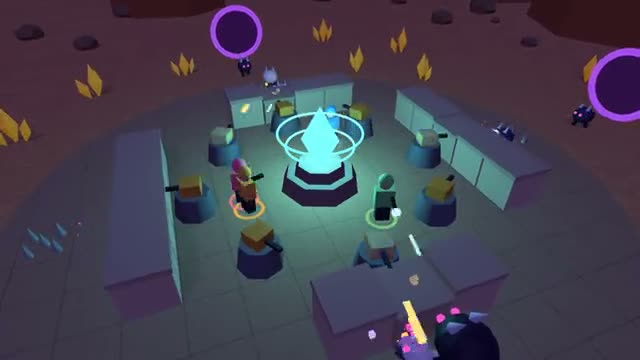

# Night Defense

Build walls by day. Hold the core all night. A multiplayer starter game from [Multiplayer Agent](https://multiplayeragent.com): 3D, co-op, 1–6 players, with bots that fill the team.

## How it plays

By day you shoot gold crystals for scrap and spend it on walls, turrets and spike traps around the core. At night monsters pour out of four portals. Last as many nights as you can.

**Controls:** WASD and mouse, hold click to shoot, 1 to 3 to pick a build and click to place, or two thumb sticks and a PLACE button.

## Make it yours in the Game Builder

Open the [Game Builder](https://multiplayeragent.com), choose **Start from a starter game** and pick Night Defense. It opens as version 1 in your studio, ready to play and publish. Then ask for changes, for example:

- Add a cannon tower that hits a whole group
- Add a flying monster that skips the walls
- Make it a snowy base with ice walls

## Run it yourself

1. Get a free publishable key (`pk_…`) at [multiplayeragent.com](https://multiplayeragent.com).
2. In `index.html`, put it in place of `pk_REPLACE_ME` in the `MP_CONNECT` block.
3. Serve the folder (for example `npx serve`) and open it. The 3D engine loads as a module, which browsers block from a file on disk.

Without a key it still runs, offline with bots.

## How it is built

- One `index.html` plus three.js in `libs/`. The comment at the top of the script maps the code and explains the multiplayer.
- **Leaderboard:** The most nights each player's team survived.
- **Host-run rules:** The host's browser runs the day and night, every monster and every turret. If it leaves, the next player takes over.
- **Bots:** AI teammates mine, build and fight until enough people join.
- **Live sync:** Every builder, wall, turret shot and monster shows up for everyone at once.
- `?attract` runs it offline with bots only. The preview video is recorded from it.

## License

MIT. three.js in `libs/` is MIT too (Copyright 2010-2024 three.js authors).
